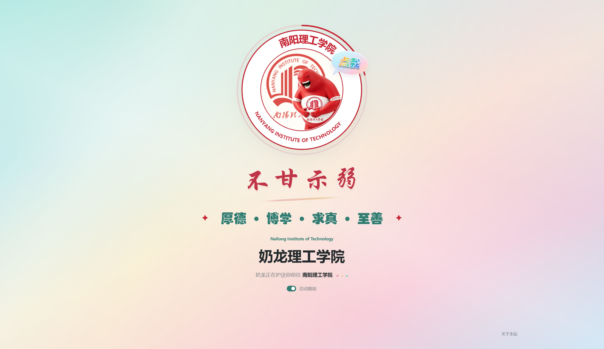

<h1 align="center">🎓 奶龙理工学院 · 高校奶龙域名跳转页</h1>

<p align="center">
  
</p>

<p align="center" style="margin-top: 8px; font-size: 18px;">
  高校奶龙域名 · <a href="https://xn--yusy8b04co90bwi3bktl.com/">奶龙理工学院.com</a> · 南阳理工学院非官方趣味跳转页
</p>

<p align="center">
  <a href="LICENSE"></a>
  
  
  
  <a href="https://github.com/GeorgeNaNN/nailong-nyist-pages"></a>
  <a href="https://github.com/GeorgeNaNN/nailong-nyist-pages/commits"></a>
</p>

<p align="center">
  <strong>Language / 语言</strong><br>
  <a href="README.md"></a>
</p>

---

## 一、简介

`nailong-nyist-pages` 是一个以 **高校奶龙域名** 为主题的非官方趣味跳转页，以南阳理工学院为创作对象，将高校校名与奶龙元素结合，制作了“奶龙理工学院.com”这一趣味域名对应的页面。

访问 [奶龙理工学院.com](https://xn--yusy8b04co90bwi3bktl.com/) 后，会先展示奶龙主题页面，再跳转到南阳理工学院官网。这是在独立注册的趣味域名上制作跳转页，并非更改学校的官方校名或官网域名。

项目使用原生 HTML、CSS 和 JavaScript 编写，部署到了 Cloudflare Pages，无需自行购买服务器，也不需要数据库或构建工具。

项目参考并基于 [Enderman112/nailong-university](https://github.com/Enderman112/nailong-university) 进行了魔改和个性化创作，结合南阳理工学院相关元素，加入了自己的排版、交互和视觉设计想法。感谢原项目提供的创意与实现参考。

页面以红色旋转圆环、分层校徽和红色奶龙为主体，搭配果冻色渐变背景、五彩“点我”气泡、手写风格的“不甘示弱”和“厚德 · 博学 · 求真 · 至善”校训，并加入奶龙点击音频和倒计时暂停控制。圆环倒计时结束后，通过校徽转场前往 [南阳理工学院官网](https://www.nyist.edu.cn/)。

> **手机端显示说明：** 当前手机端暂无法完整渲染炫彩字体效果，字体显示可能与电脑端不同，具体以所用浏览器和系统为准；不影响音频播放、倒计时和官网跳转功能。

**非官方，仅整活分享。“奶龙理工学院”是趣味校名，本项目与南阳理工学院无官方关联。**

页面使用的“奶龙捧腹大笑”音频下载自 [爱给网 · 奶龙音效](https://www.aigei.com/sound/class/nai_long_d/)。

奶龙形象及相关音频、校徽等第三方素材的权利归各自权利人所有。素材仅用于非官方趣味展示，不表示获得相关权利人的授权或背书。

## 二、项目信息

- 作者：[GeorgeNaNN](https://github.com/GeorgeNaNN)
- 版本：`2.0`
- 项目名：`nailong-nyist-pages`
- 项目定位：高校奶龙域名 / 南阳理工学院非官方趣味跳转页
- 仓库：[nailong-nyist-pages](https://github.com/GeorgeNaNN/nailong-nyist-pages)
- 访问地址：[奶龙理工学院.com](https://xn--yusy8b04co90bwi3bktl.com/)
- 跳转目标：[南阳理工学院官网](https://www.nyist.edu.cn/)
- 技术栈：`HTML` / `CSS` / `JavaScript`
- 部署平台：`Cloudflare Pages`，也可使用支持根目录部署的静态网站托管服务
- 参考项目：[Enderman112/nailong-university](https://github.com/Enderman112/nailong-university)

## 三、文件结构

```text
nailong-nyist-pages/
├── index.html                  # 页面结构、样式、交互和跳转逻辑
├── ring.webp                   # 旋转校名圆环
├── badge-emblem.webp           # 中央校徽及转场校徽
├── badge-mascot.webp           # 可点击的红色奶龙
├── favicon.png                 # 浏览器标签页及 Apple 触屏图标
├── ring-og.jpg                 # 分享预览图，不在页面正文中显示
├── 奶龙捧腹大笑.mp3             # 点击奶龙播放的音频
├── example_images/             # README 示例图
│   ├── preview-desktop.png     # 电脑端示例
│   └── preview-mobile.png      # 手机端示例
├── README.md                   # 项目说明文档
└── LICENSE                     # MIT 协议及版权声明
```

## 四、部署与预览

### Cloudflare Pages 部署

1. 下载本项目，确认待上传目录的根层级中有 `index.html` 和对应图片、音频文件。
2. 在 Cloudflare 的 Workers 和 Pages 中创建 Pages 项目，选择直接上传静态资源。
3. 上传项目文件夹或符合上传要求的 ZIP 压缩包；不要让 `index.html` 外面多套一层项目目录。
4. 部署完成后，先通过分配的 `*.pages.dev` 地址检查页面、音频和跳转。
5. 如需使用自己的域名，在 Pages 项目的“自定义域”中添加，并按控制台提示完成 DNS 配置。需要同时支持根域名和 `www` 时，应分别添加这两个域名。
6. 更新页面时，在同一个 Pages 项目中创建新的生产部署，重新上传完整文件即可，无需重新创建项目。

### 本地预览

页面图片使用了 `/ring.webp` 等站点根路径，建议通过本地静态服务预览，不要直接双击 HTML，也不要未经调整就部署到子目录。

如已安装 Python，可在包含 `index.html` 的项目目录中运行：

```bash
python -m http.server 8792 --bind 127.0.0.1
```

浏览器打开：

- 正常跳转：[http://127.0.0.1:8792/](http://127.0.0.1:8792/)
- 仅预览、不离开本站：[http://127.0.0.1:8792/?stay](http://127.0.0.1:8792/?stay)

预览模式仍会运行倒计时和转场。如需停留查看静态排版，可以关闭页面上的“自动跳转”开关。

## 五、页面示例图

### 电脑端



### 手机端


